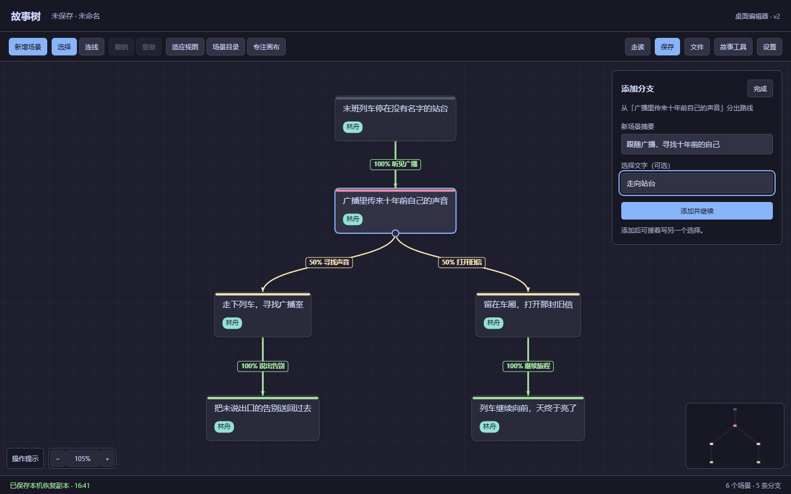

# 故事树 · Story Tree

在画布上写场景、创建分支、调整路线，再沿着不同选择走读故事。

故事树是一个 **Tauri 桌面故事编辑器**，适合构思多结局故事、互动小说和剧情流程。支持正文、角色、世界观、条件与本地 JSON 文件；基础创作无需配置 AI。



[上手教程](TUTORIAL.md) · [更新记录](CHANGELOG.md) · [轻量网页版](https://github.com/fisHarly0/story-tree)

## 先体验一个故事

下载源码后，直接用浏览器打开 `src/index.html`，无需安装 Rust。

1. 点击 **体验示例故事**，打开包含 6 个场景、5 条分支的离线示例。
2. 选中一个场景，点击旁边的 **添加分支**，填写新场景摘要与选择文字。
3. 点击 **添加并继续**，从同一起点写下一条路线；写完点击 **完成**。
4. 选中起始场景，点击 **走读**，沿着不同选择检查结局。
5. 点击 **保存** 下载 JSON；下次通过 **文件 → 打开** 继续编辑。

也可以点击 **创建第一个场景** 从空白开始。浏览器预览通过下载保存文件；原生桌面窗口的启动方法见下方。

## 在画布上创建与修改故事

| 想做什么 | 如何操作 |
|---|---|
| 接着写下一幕 | 从场景底部圆点拖到空白处，或选中场景后点击 **接下一幕** |
| 从同一起点写多个选择 | 点击 **添加分支**，同时填写场景摘要与选择文字，逐次 **添加并继续** |
| 连接已有场景 | 从场景底部圆点拖到目标场景 |
| 把路线改接到其他场景 | 选中连线，拖动起点或终点圆点到新场景；原选择文字、概率与条件保留 |
| 在路线中间加一幕 | 选中连线，点击 **插入场景**：A → B 变为 A → 新场景 → B |
| 修改选择文字 | 双击连线，或点击连线旁的 **选择文字** |
| 一起移动多个场景 | Shift 点击多选，或 Shift 从空白处拖动框选，再拖动任意已选场景 |
| 查找一段内容 | 打开 **场景目录**，搜索摘要、正文、备注或角色，点击结果跳转 |

新建分支会自动避开已有场景。插入场景时，原路线的条件和概率保留在前一段，后一段以 100% 概率连接原目标。新增、改接、插入、删除和移动均支持撤销；拖动途中按 `Esc` 可取消。

顶部 **专注画布** 可收起详情栏，**故事工具** 集中放置世界观、统计等功能，**文件** 菜单提供打开、另存为和导出。

### 常用快捷操作

| 操作 | 快捷键 / 手势 |
|---|---|
| 平移画布 | 空格 + 拖动，或鼠标中键拖动 |
| 缩放 / 适应全图 / 恢复 100% | 滚轮 / `F` / `1` |
| 新建场景 / 接下一幕 | `N` / 选中场景后按 `Tab` |
| 就地编辑摘要 / 完成编辑 | `Enter` / `Ctrl+Enter` |
| 放弃编辑草稿或取消当前手势 | `Esc` |
| 场景目录 / 搜索 | `Ctrl+K` / `Ctrl+F` |
| 复制选中场景 | `Ctrl+D` |
| 撤销 / 重做 | `Ctrl+Z` / `Ctrl+Y` 或 `Ctrl+Shift+Z` |
| 保存 / 另存为 | `Ctrl+S` / `Ctrl+Shift+S` |

画布快捷键在输入框外使用；就地编辑时按 `Ctrl+Enter` 提交摘要。复制保留场景内容与条件，不自动复制连线。更多操作见 [上手教程](TUTORIAL.md)。

## 创作工具

- **场景内容**：摘要、正文、备注、角色标签、收藏与场景目录。
- **故事结构**：分支概率、条件、子图、自动排列、撤销与重做。
- **世界设定**：世界观预设，以及角色、物品、地点实体库。
- **互动走读**：变量、物品、标记、掷骰和随机事件，沿不同路线检查故事。
- **导出与保存**：本地 JSON 文件，以及文件菜单中的图片等导出功能。
- **可选 AI**：根据世界观与上下文生成分支，先预览再添加；支持取消、重试和批量添加。

桌面版可导入 v1 故事，保存为 [v2 格式](story-tree.schema.json)。轻量网页版侧重基础分支图，不能完整处理桌面版的正文、世界观、实体和条件字段；**v2 故事请继续用本项目编辑**。导入先校验数据，失败不会替换当前故事。

## 保存与恢复

原生桌面窗口通过 **保存** 写入 JSON 文件，通过 **文件 → 另存为** 保留另一份版本。对已打开的文件，每 30 秒尝试自动保存；保存失败时继续显示未保存状态，关闭窗口时会提示未保存修改。

编辑器也会保存当前设备上的恢复副本。底部状态栏显示恢复副本是否写入成功；容量不足或副本损坏时会提示处理。**恢复副本不等于独立文件备份**，清理浏览器或应用数据可能使其丢失，请定期保存 JSON。无法解析的旧副本会保留，不会被新编辑静默覆盖。

## 可选 AI 设置

在 **设置** 中填写兼容 Chat Completions 的接口地址、密钥和模型。请求会将密钥和相关故事内容发送到所填接口；服务可用性与费用由提供商决定。

密钥默认仅保留在当前会话。勾选 **在此设备记住密钥** 后才会持久保存，也可以点击 **清除已保存的密钥** 删除；本地存储不加密。**导出的故事 JSON 不包含接口密钥**，其中的 `aiConfig` 只保存故事设定和生成偏好。

分支生成可使用相关路线或全故事上下文，过长内容会截取。生成期间可取消，请求超过 90 秒会结束并提示重试。浏览器预览可能受到接口跨域限制；自动化测试使用模拟响应，尚未验证真实 AI 服务的兼容性与生成质量。

## 桌面开发与构建

需要 Node.js、Rust，以及 [Tauri 对应平台依赖](https://v2.tauri.app/start/prerequisites/)。Windows 使用 MSVC 工具链与 WebView2。

```bash
git clone https://github.com/fisHarly0/story-tree-app.git
cd story-tree-app
git checkout polish/2026-10-04
npm ci
npm run dev
```

```bash
npm run check        # 检查编辑器 JavaScript 语法
npm run build        # 构建原生应用及安装包
```

默认产物位于 `src-tauri/target/release/`；设置了 `CARGO_TARGET_DIR` 时以该目录为准。目前尚未发布 GitHub 安装包。

前端入口为 `src/index.html`，桌面壳在 `src-tauri/`，数据契约为 `story-tree.schema.json`。

## 验证

```bash
python -m pip install -r tests/requirements.txt
python -m playwright install chromium
python tests/browser_smoke.py --output ./test-results/smoke
python tests/editor_regression.py --output ./test-results/editor
python tests/canvas_interaction.py --output ./test-results/canvas
python tests/structure_workflow.py --output ./test-results/structure
```

可用 `--output <目录>` 指定报告位置，用 `STORY_BROWSER_EXECUTABLE` 指定已有 Chromium。

本轮已通过 164 项浏览器、数据与操作流程检查，以及 14 项 Windows 原生 WebView、文件保存和画布操作检查；JavaScript 语法检查、Rust 检查与 Windows 调试构建均通过。原生检查不等同于安装包验收，其他操作系统及实体触控设备尚未实测。
